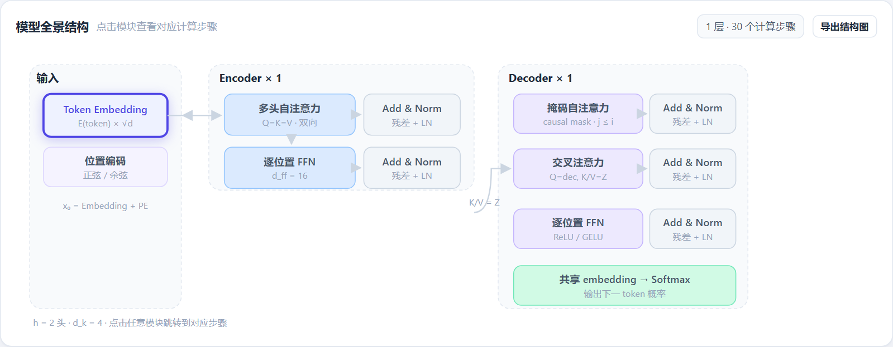
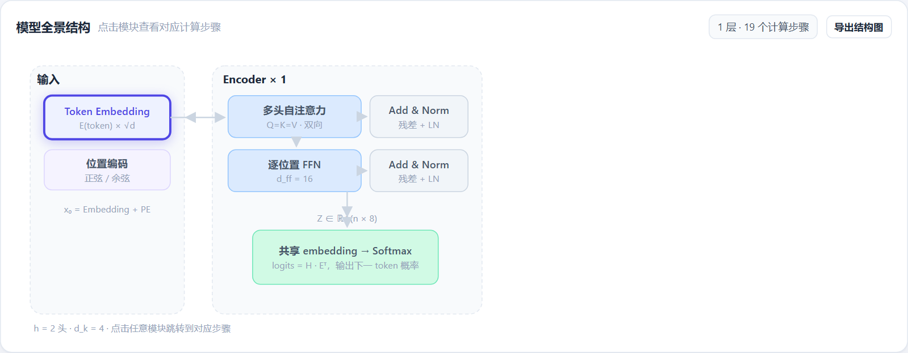
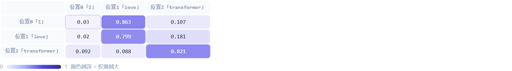
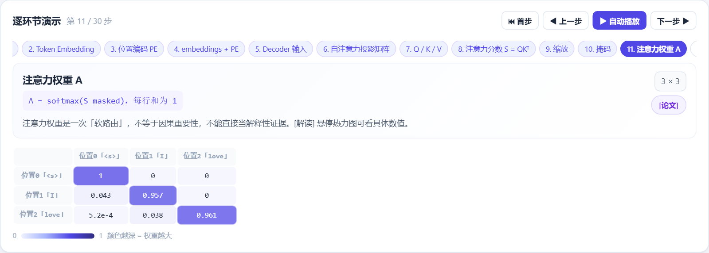
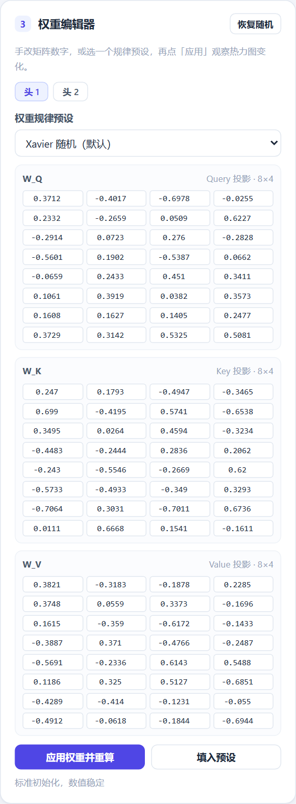
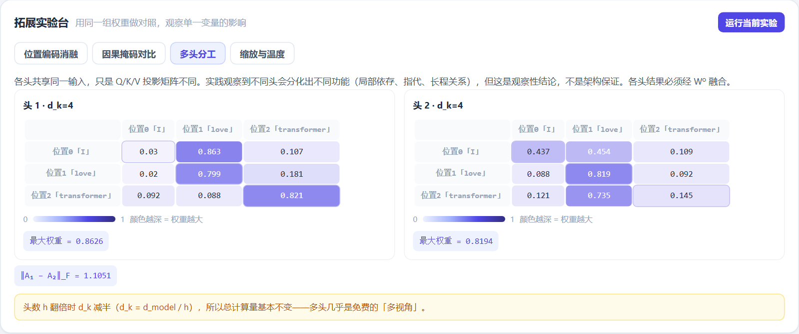
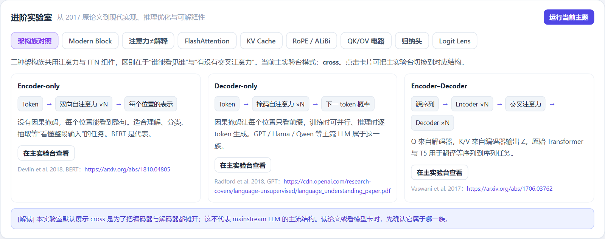
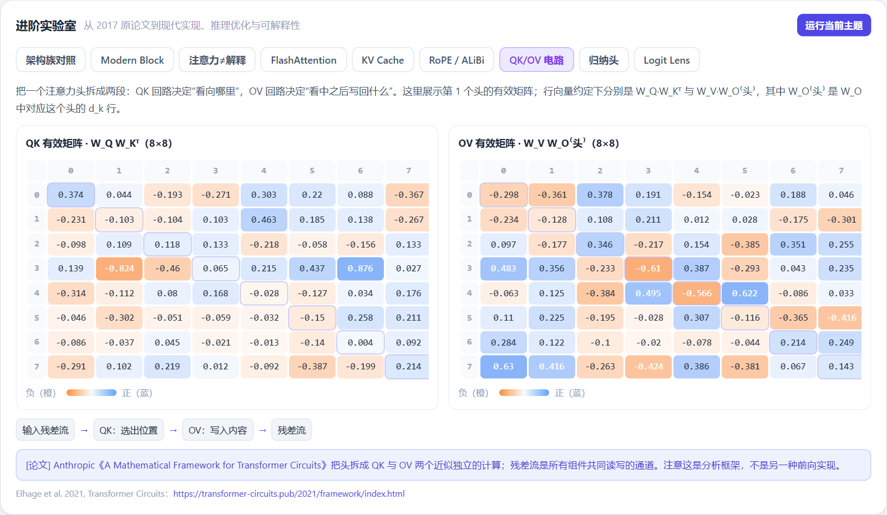
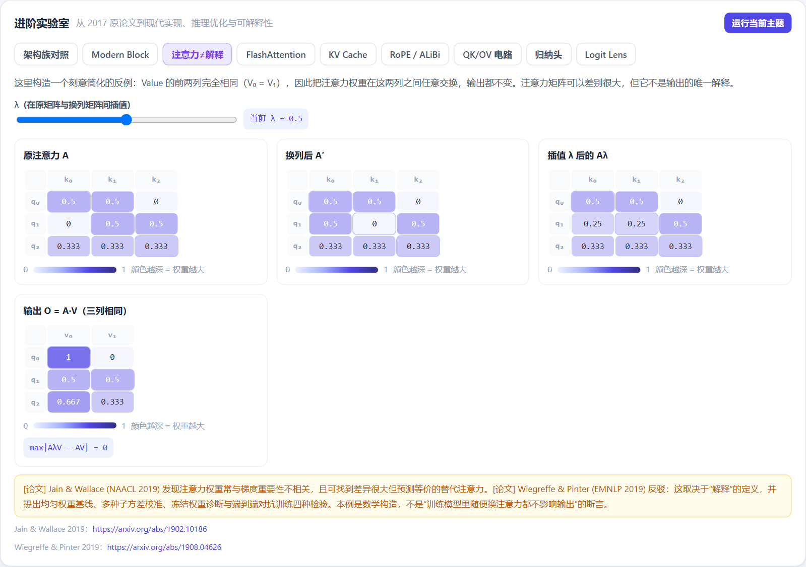
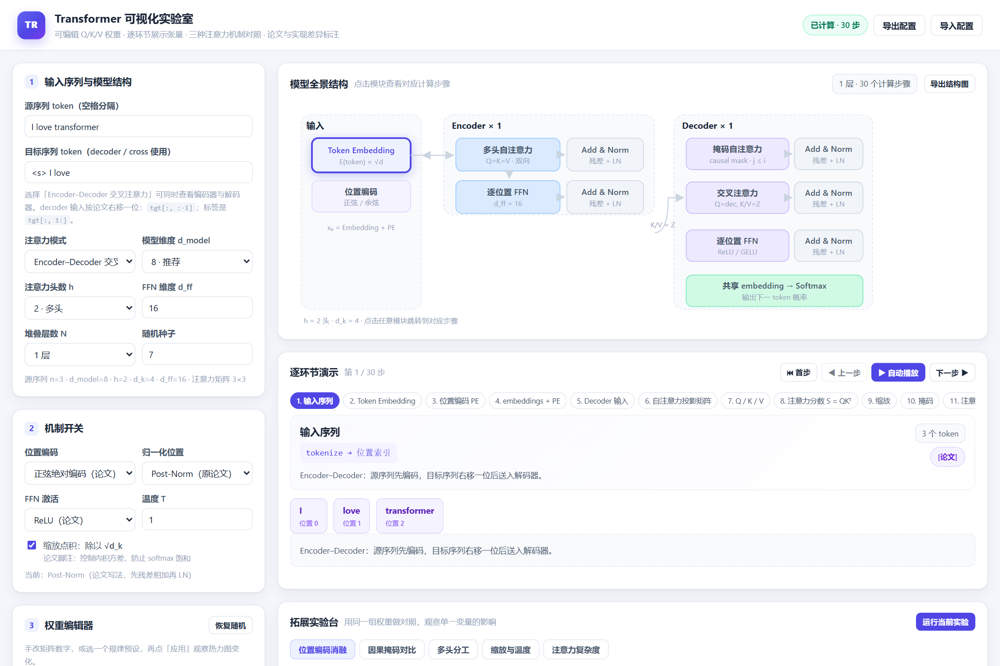

# Transformer 可视化实验室

[](https://github.com/sinianhai181-png/transformer-lab/actions/workflows/test.yml)
[](LICENSE)
[](package.json)

把 Transformer 论文里的每一步张量摊开给你看：自己改 Q/K/V 权重、输入 token 和超参数，逐步观察注意力矩阵、多头分工、掩码、归一化与输出概率如何变化。

这是 [BP 神经网络反向传播实验台](https://github.com/sinianhai181-png/bp-neural-network-lab) 的姊妹项目，延续同一套设计原则：**零依赖、双击运行、逐环节可观测、数值与论文对齐、可编辑而非只看动画**。

## 快速开始

直接用浏览器打开 `index.html` 即可，不需要安装任何东西、不需要联网、不需要构建。

```bash
# 直接双击 index.html，或：
start index.html          # Windows
open index.html           # macOS
```

运行测试（需要 Node.js 18+，DOM 测试依赖 jsdom）：

```bash
npm install
npm test
```

当前测试：**95 项全部通过**，覆盖矩阵运算、位置编码、掩码、形状不变量、可编辑权重、序列化，以及界面初始化、参数联动、播放器、权重编辑、五个对照实验、九个进阶主题与结构图导出。

## 界面预览

以下截图均由真实浏览器运行本页面后拍摄，未做后期修饰。

默认打开即为 **Encoder–Decoder 交叉注意力（cross）** 模式，全景图同时呈现编码器与解码器；在「注意力模式」中也可切换为仅 Encoder 或仅 Decoder。

| 完整编码器—解码器（cross 模式，默认） | 编码器自注意力模式（可切换） |
| --- | --- |
|  |  |

| 注意力权重热力图 | 逐环节步骤面板 |
| --- | --- |
|  |  |

| 权重编辑器 | 多头分工实验 |
| --- | --- |
|  |  |

| 进阶实验室 · 架构族对照 | 进阶实验室 · QK/OV 电路 |
| --- | --- |
|  |  |

| 进阶实验室 · 注意力≠解释 | 首屏总览 |
| --- | --- |
|  |  |

## 能改什么

| 类别 | 可编辑内容 |
| --- | --- |
| 输入 | 源序列 token、目标序列 token（可增删、改顺序） |
| 结构 | 注意力模式（Encoder 双向 / Decoder 因果 / Encoder–Decoder 交叉）、d_model、头数 h、FFN 维度、堆叠层数 |
| 机制 | 位置编码（正弦 / 可学习 / 无）、归一化位置（Post-Norm / Pre-Norm）、FFN 激活（ReLU / GELU）、缩放开关、温度 T、随机种子 |
| 权重 | 每个头的 `W_Q / W_K / W_V` 矩阵逐格编辑；五个规律预设（关注自己 / 前一个 / 首个 / 均匀 / 随机）；整个配置可导出导入 |

## 看得到什么

- **全景结构图**：默认即可同时看到 Encoder 与 Decoder 两栈、残差与归一化、交叉注意力的 K/V 来源；也可切换为单栈模式。点击任一模块跳到对应计算步骤。
- **逐环节演示**：从 tokenize、embedding×√d、位置编码、QKV 投影、`QKᵀ`、缩放、掩码、softmax、加权求和、多头拼接、`Wᴼ`、Add&Norm、FFN，到共享 embedding 的输出概率，共 19–30 个步骤，可单步或自动播放。
- **张量数值**：每步显示完整矩阵、张量形状、公式、来源标注（`[论文]` / `[实现]` / `[解读]`）和一句解释。
- **注意力热力图**：行是 Query 位置、列是 Key 位置，悬停查看具体权重；分数矩阵用发散色，注意力权重用单色深浅。
- **五个对照实验**：位置编码消融、因果掩码对比、多头分工、缩放与温度、注意力复杂度 `O(n²)`。
- **进阶实验室**：九个可交互主题——架构族对照、Modern Block、注意力≠解释、FlashAttention、KV Cache、RoPE/ALiBi、QK/OV 电路、归纳头、Logit Lens。每个主题都标出论文、实现或解读等级，详见 [docs/ADVANCED.md](docs/ADVANCED.md)。

## 严谨性：资料等级与标注

项目基于仓库内的 [docs/TRANSFORMER.md](docs/TRANSFORMER.md) 整理的一手资料，界面中每个步骤都标了出处：

- **`[论文]`** — Vaswani et al., *Attention Is All You Need*, arXiv:1706.03762v7。结构、公式、超参数、复杂度表的唯一权威依据。
- **`[实现]`** — Harvard NLP, *The Annotated Transformer*。张量形状、掩码构造、teacher forcing，以及论文文字与实际代码不一致的地方。
- **`[解读]`** — 学界常见解释，论文未直接论证；界面明确单独标出，不与论文结论混为一谈。

因此你会看到这些被如实呈现的差异，而不是被抹平成一句"常识"：

- 论文是 **Post-Norm**，哈佛实现和现代大模型是 **Pre-Norm**。
- 论文要求 embedding 与输出层 **共享权重**，哈佛教学实现默认 **不共享**。
- 缩放的直接原因是 **控制点积方差、避免 softmax 饱和导致梯度消失**，不是笼统的"防止数值溢出"。
- 论文写掩码为 `−∞`，实现用 `−1e9` 近似。
- "注意力权重 = 模型在关注什么"只是软路由，不是因果解释证据。

完整的 Transformer 知识整理见 [docs/TRANSFORMER.md](docs/TRANSFORMER.md)，进阶主题与一手来源见 [docs/ADVANCED.md](docs/ADVANCED.md)，公式推导见 [docs/MATH.md](docs/MATH.md)，实验说明见 [docs/EXPERIMENTS.md](docs/EXPERIMENTS.md)，贡献约定见 [CONTRIBUTING.md](CONTRIBUTING.md)。

## 目录结构

```
transformer-lab/
├── index.html              # 页面结构
├── css/style.css           # 浅色主题与可视化样式
├── js/engine.js            # 核心计算：矩阵、注意力、多头、FFN、归一化、快照
├── js/visualizer.js        # 全景 SVG、矩阵表、热力图、折线图
├── js/app.js               # 控件联动、播放器、权重编辑、导入导出
├── js/lab.js               # 五个对照实验
├── js/advanced.js          # 九个进阶主题
├── tests/
│   ├── engine.test.js      # 数值与不变量
│   ├── dom.test.js         # 界面交互
│   └── run-all.js          # 测试入口
├── docs/
│   ├── TRANSFORMER.md       # Transformer 系统整理：论文、实现、变体与澄清
│   ├── ADVANCED.md          # 九个进阶主题、一手来源与边界
│   ├── MATH.md              # 公式与维度推导
│   ├── EXPERIMENTS.md       # 实验说明
│   └── assets/              # 真实浏览器截图
├── .github/workflows/test.yml  # Node 18/20/22 CI
├── README.md / CHANGELOG.md / CONTRIBUTING.md / LICENSE
├── package.json
└── package-lock.json
```

## 已知边界

- 这是**教学玩具规模**（d_model 4/8/16，层数 1–3），不追求语言建模能力；输出概率是词表内的演示值，不是训练好的模型。
- 不做反向传播与训练。若要学"权重是怎么学出来的"，请用姊妹项目 BP 实验台。
- 主引擎没有 batch 维、没有 dropout、没有 KV Cache；进阶实验室的 KV Cache、RoPE、GQA 等是独立演示，不改变主前向结果。
- RMSNorm、SwiGLU 等现代组件没有进入主引擎；它们只在「Modern Block」主题中与论文结构做对照。
- FFN 的 γ/β、LayerNorm 的可学习参数固定为 1/0；位置编码的"可学习"模式是固定随机查表，不参与训练。
- 权重编辑器暴露的是每个头的 Q/K/V 投影；`Wᴼ`、FFN 权重和 embedding 由随机种子决定，可复现但不可在界面逐格修改。

## 许可证

MIT © sinianhai181-png
